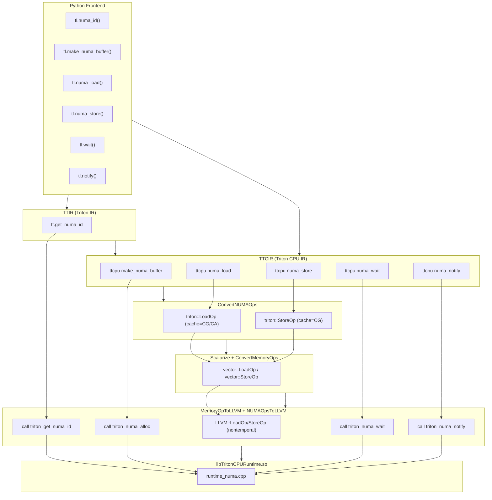
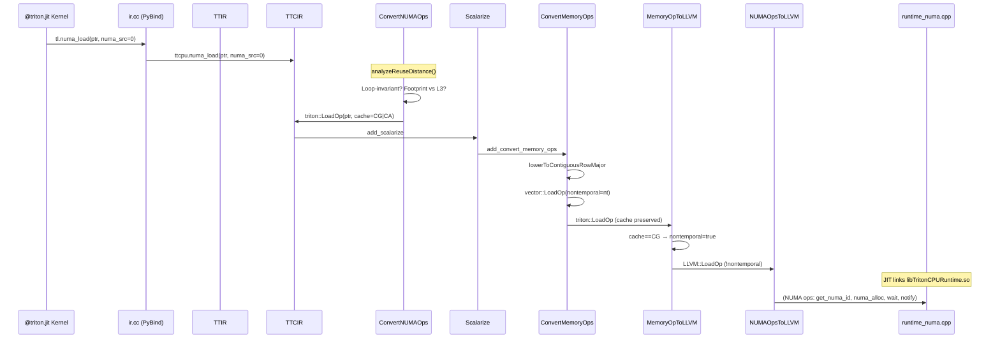
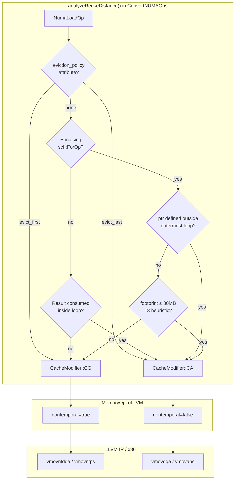

# NUMA Extension for Triton-CPU — Developer Guide

> **Scope**: This document synthesizes the design, implementation, and integration of the NUMA-aware extension for Triton-CPU, as implemented across commits `2adfa59` through `63d27de`. It provides a comprehensive guide for developers working with or extending NUMA support.

---

## 1. Feature Overview

### Executive Summary

The **NUMA Extension** adds first-class support for Non-Uniform Memory Access (NUMA) to the Triton-CPU backend. On multi-socket servers, each CPU socket has its own directly-attached RAM, forming distinct NUMA nodes. Without explicit control, the OS may place memory and threads on different nodes, causing remote accesses to traverse the interconnect—a **~40% latency penalty** compared to local access.

This feature provides:

1. **Explicit NUMA memory placement** — Allocate buffers pinned to specific NUMA nodes via `tl.make_numa_buffer(shape, dtype, numa_node)`
2. **NUMA-annotated load/store** — `tl.numa_load` and `tl.numa_store` with `numa_src`/`numa_dst` attributes for remote access hints
3. **Adaptive cache bypassing** — Polyhedral reuse analysis selects streaming (CG) or temporal (CA) cache modifiers, emitting non-temporal LLVM instructions where appropriate
4. **Cross-socket synchronization** — Lightweight `tl.wait` / `tl.notify` for producer-consumer coordination across NUMA nodes

### Problem Solved

| Concern | Without NUMA Extension | With NUMA Extension |
|---------|------------------------|---------------------|
| **Memory placement** | OS first-touch policy (unpredictable) | Explicit per-node allocation via `triton_numa_alloc` |
| **Thread scheduling** | OS may migrate across sockets | `triton_numa_pin_thread` pins to NUMA node cores |
| **Remote access hints** | No cache bypass; pollutes L3 | Streaming loads/stores bypass cache (`vmovntdqa`/`vmovntps`) |
| **Cross-node sync** | Generic locks (cache-line bouncing) | Futex-based signaling with spin-then-sleep |

### Expected Behavior

- **`tl.numa_id()`** returns the NUMA node ID of the current execution context
- **`tl.make_numa_buffer(shape, dtype, numa_node)`** allocates memory on the specified node; `numa_node` may be a runtime value (e.g., `tl.numa_id()`)
- **`tl.numa_load(ptr, numa_src=N, mask=..., other=...)`** loads from remote memory; the compiler assigns cache modifiers based on reuse analysis
- **`tl.numa_store(ptr, value, numa_dst=N, mask=...)`** stores to remote memory; always uses non-temporal semantics
- **`tl.wait(signal_id)`** blocks until signaled
- **`tl.notify(signal_id, numa_dst)`** wakes a waiter on the target node

---

## 2. Architecture & System Flow

### High-Level Data Flow

The NUMA extension spans four layers: Python frontend, TTIR, TTCIR, and LLVM IR, with a C++ runtime linked at the end.



### Mermaid Sequence Diagram: End-to-End NUMA Load Path



### Mermaid Flowchart: Reuse Analysis Decision Tree



### Pipeline Ordering (Critical)

The compiler pipeline enforces a strict pass ordering. Violating it causes either unconverted NUMA ops to reach NUMAOpsToLLVM (triggering fallback errors) or cache modifiers to be lost.

| Stage | Pass | Purpose |
|-------|------|---------|
| **TTCIR** | `add_convert_numa_ops` | **First** — Rewrites NumaLoadOp/NumaStoreOp → triton::LoadOp/StoreOp before scalarization |
| TTCIR | `add_scalarize` | Decomposes tensor ops to scalar/loop form |
| TTCIR | `add_convert_memory_ops` | Lowers triton::LoadOp/StoreOp to vector ops (preserves cache attr) |
| **LLIR** | `add_memory_op_to_llvmir` | Propagates cache modifier → nontemporal on LLVM ops |
| LLIR | `add_numa_ops_to_llvmir` | Lowers remaining NUMA ops to runtime calls; fallback errors for unconverted load/store |

**Why this order?** NumaLoadOp produces tensor-typed results that require scalarization. The scalarize and memory-op-conversion passes only handle `triton::LoadOp`/`triton::StoreOp`. By rewriting early, NUMA loads flow through the standard pipeline with cache modifiers intact.

---

## 3. Core Components & Design Decisions

### 3.1 Two-Stage Lowering for NUMA Load/Store

**Decision**: Split NUMA load/store handling across `ConvertNUMAOps` (TTCIR) and `MemoryOpToLLVM` (LLIR). NumaLoadOp/NumaStoreOp are **not** lowered directly in NUMAOpsToLLVM.

**Rationale**:
- `ConvertMemoryOps` and `ScalarizeUsingForOps` only process `triton::LoadOp`/`triton::StoreOp`
- NumaLoadOp can carry tensor types (`tensor<128 x !tt.ptr<f32>>`) that require scalarization
- By rewriting to triton::LoadOp early, the generated ops inherit the full scalarize → memory-op-conversion → vector lowering pipeline
- NUMAOpsToLLVM contains **fallback** patterns that emit errors if NumaLoadOp/NumaStoreOp survive—a safety net for pipeline bugs

### 3.2 Polyhedral Reuse Analysis

**Decision**: Implement `analyzeReuseDistance()` in ConvertNUMAOps to assign `CacheModifier::CG` (streaming) or `CacheModifier::CA` (temporal) based on loop structure and access patterns.

**Rationale**:
- **KV-cache pattern**: Loop-invariant pointer, same tile every iteration → high reuse → CA (use cache)
- **Weight streaming**: IV-dependent pointer, sequential access → low reuse → CG (bypass cache)
- **Default**: When analysis is inconclusive, default to CG. Remote data that is not demonstrably reused should not pollute the local L3 cache.

**Heuristics** (in order):
1. Explicit `eviction_policy` attribute → direct mapping
2. No enclosing loops: if result consumed inside a downstream loop → CA
3. Loop-invariant ptr (defined outside outermost loop) → CA
4. Footprint (tripCount × tileBytes) ≤ 30 MB (L3 heuristic) → CA
5. Otherwise → CG

### 3.3 NumaStoreOp Always CG

**Decision**: All `NumaStoreOp` conversions use `CacheModifier::CG` and `EvictionPolicy::EVICT_FIRST`.

**Rationale**: Remote stores write to memory on another NUMA node. Caching that data locally wastes L3 capacity. Non-temporal stores (`vmovntps`/`vmovntdq`) bypass the cache and write directly to memory.

### 3.4 Operand Broadcasting for Tensor Pointers

**Decision**: When converting NumaLoadOp with a tensor pointer, insert `triton::SplatOp` to broadcast scalar `mask` and `other` operands to the correct tensor shape.

**Rationale**: The scalarize pass expects operands to match the pointer's tensor shape. Without broadcasting, type mismatches cause conversion failures. This fix was introduced in commit `63d27de`.

### 3.5 Runtime: Three-Tier Platform Abstraction

**Decision**: Graceful degradation across Linux+libnuma, Linux-only, and non-Linux.

| Tier | Condition | Memory | Pinning | Signaling |
|------|-----------|--------|---------|-----------|
| 1 | `__linux__` + `TRITON_HAS_NUMA` | `numa_alloc_onnode` | `numa_sched_setaffinity` | futex |
| 2 | `__linux__` only | `mmap` + `mbind` | no-op | futex |
| 3 | Other OS | `malloc` | no-op | spin-yield |

**Rationale**: Enables development and testing on systems without libnuma. CMake sets `TRITON_HAS_NUMA` when `find_library(LIBNUMA numa)` succeeds.

### 3.6 Dynamic `numa_node` for make_numa_buffer

**Decision**: `MakeNumaBufferOp` accepts an `I32` operand (runtime `Value`) for `numa_node`, not just a compile-time `IntegerAttr`.

**Rationale**: Allows `tl.make_numa_buffer((128,), tl.float32, tl.numa_id())`—the NUMA node is determined at runtime. The NUMAOpsToLLVM pass fetches `adaptor.getNumaNode()` as a `Value`, not an attribute.

---

## 4. Detailed Implementation (By Module/Domain)

### 4.1 MLIR Ops (TableGen)

**Files**: `include/triton/Dialect/Triton/IR/TritonOps.td`, `include/triton/Dialect/TritonCPU/IR/TritonCPUOps.td`

| Op | Dialect | Purpose |
|----|---------|---------|
| `tt.get_numa_id` | Triton | Returns NUMA node ID of current context |
| `ttcpu.make_numa_buffer` | TritonCPU | Allocate buffer on specified NUMA node; `numa_node` is `I32` operand |
| `ttcpu.numa_load` | TritonCPU | Load with `numa_src` attribute; optional mask, other |
| `ttcpu.numa_store` | TritonCPU | Store with `numa_dst` attribute; optional mask |
| `ttcpu.numa_wait` | TritonCPU | Block on `signal_id` |
| `ttcpu.numa_notify` | TritonCPU | Signal `signal_id` to `numa_dst` |

**NumaLoadOp** supports optional `mask` and `other` (for masked loads). The `numa_src` attribute is a scheduling hint; the actual cache modifier is derived by reuse analysis.

### 4.2 Python Frontend & Bindings

**Files**: `python/triton/language/semantic.py`, `python/triton/language/core.py`, `python/src/ir.cc`

**Semantic layer** (`semantic.py`):
- `numa_id(builder)` → `builder.create_get_numa_id()`
- `make_numa_buffer(shape, dtype, numa_node, builder)` → `to_tensor(numa_node)` then `builder.create_make_numa_buffer(...)`
- `numa_load(ptr, numa_src, mask, other, builder)` → `builder.create_numa_load(...)`
- `numa_store(ptr, value, numa_dst, mask, builder)` → `builder.create_numa_store(...)`
- `numa_wait(signal_id, builder)` → `builder.create_numa_wait(signal_id)`
- `numa_notify(signal_id, numa_dst, builder)` → `builder.create_numa_notify(...)`

**Core layer** (`core.py`): `tl.wait` and `tl.notify` delegate to `semantic.numa_wait` and `semantic.numa_notify`.

**C++ bindings** (`ir.cc`): `TritonOpBuilder` exposes `create_get_numa_id`, `create_make_numa_buffer`, `create_numa_load`, `create_numa_store`, `create_numa_wait`, `create_numa_notify`. `create_numa_load` infers result type from the pointer's pointee type.

### 4.3 ConvertNUMAOps

**File**: `third_party/cpu/lib/TritonToTritonCPU/ConvertNUMAOps.cpp`

**Conversion target**: Marks `NumaLoadOp` and `NumaStoreOp` as **illegal**; `GetNumaIdOp` and other NUMA ops remain legal.

**Key logic**:

```cpp
// analyzeReuseDistance() — decision hierarchy
if (policyAttr == "evict_first") return CacheModifier::CG;
if (policyAttr == "evict_last")  return CacheModifier::CA;

if (enclosingLoops.empty()) {
  for (user : result.getUsers())
    if (user has ancestor scf::ForOp) return CA;  // out-of-loop load consumed in loop
  return CG;
}

if (outermostLoop.isDefinedOutsideOfLoop(ptr)) return CA;

footprint = tripCount * tileBytes;
if (footprint <= kDefaultL3CapacityBytes) return CA;

return CG;
```

**NumaLoadToLoadConversion**: Creates `triton::LoadOp` with computed `cache` and `evict`. For tensor ptr types, splats scalar `mask`/`other` to tensor shape via `triton::SplatOp`.

**NumaStoreToStoreConversion**: Always emits `triton::StoreOp` with `CacheModifier::CG` and `EvictionPolicy::EVICT_FIRST`.

### 4.4 ConvertMemoryOps (lowerToContiguousRowMajor)

**File**: `third_party/cpu/lib/TritonToTritonCPU/ConvertMemoryOps.cpp`

When lowering `triton::LoadOp` to `vector::LoadOp` (unmasked path):

```cpp
bool nt = (loadOp.getCache() == CacheModifier::CG);
vec = rewriter.create<vector::LoadOp>(loc, subVecTy, memRef,
                                      ValueRange{zeroIdx},
                                      /*nontemporal=*/nt);
```

Similarly for `vector::StoreOp`. The `vector` dialect carries the nontemporal attribute; `ConvertVectorToLLVM` propagates it to LLVM IR.

### 4.5 MemoryOpToLLVM

**File**: `third_party/cpu/lib/TritonCPUToLLVM/MemoryOpToLLVM.cpp`

**LoadOpConversion** and **StoreOpConversion** map `CacheModifier::CG` to `nontemporal=true` on `LLVM::LoadOp`/`LLVM::StoreOp`. On x86, this produces `vmovntdqa` (loads) and `vmovntps`/`vmovntdq` (stores).

### 4.6 NUMAOpsToLLVM

**File**: `third_party/cpu/lib/TritonCPUToLLVM/NUMAOpsToLLVM.cpp`

| Op | LLVM lowering |
|----|---------------|
| `tt.get_numa_id` | `call @triton_get_numa_id() -> i32` |
| `ttcpu.make_numa_buffer` | `call @triton_numa_alloc(size, node) -> ptr`; `node` from `adaptor.getNumaNode()` |
| `ttcpu.numa_wait` | `call @triton_numa_wait(signal_id)` |
| `ttcpu.numa_notify` | `call @triton_numa_notify(signal_id, node)` |

**Fallback patterns**: `NumaLoadOpFallback` and `NumaStoreOpFallback` emit `emitOpError()` if unconverted NUMA load/store ops reach this pass.

### 4.7 Runtime

**File**: `third_party/cpu/runtime/runtime_numa.cpp`

**Exported symbols** (all `extern "C"` with `EXPORT` visibility):

- `triton_get_numa_id()` → NUMA node of current CPU (sched_getcpu + libnuma/sysfs)
- `triton_numa_alloc(size_bytes, numa_node)` → NUMA-pinned allocation
- `triton_numa_free(ptr, size_bytes)` → Free NUMA allocation
- `triton_numa_pin_thread(numa_node)` → Pin thread to node
- `triton_numa_wait(signal_id)` → Spin (1024 iters) then futex wait
- `triton_numa_notify(signal_id, numa_dst)` → Set signal, futex_wake

See `docs/numa_triton/numa_runtime_developer_guide.md` for full API and concurrency details.

### 4.8 Build Integration

**File**: `third_party/cpu/CMakeLists.txt`

- `runtime_numa.cpp` added to `TRITON_CPU_RUNTIME_SOURCES`
- `find_library(LIBNUMA numa)` — if found, sets `TRITON_HAS_NUMA` and links libnuma
- `TritonCPURuntime` links `TritonCPURuntime` (shared library)

### 4.9 Compiler Pipeline

**File**: `third_party/cpu/backend/compiler.py`

- `make_ttcir`: `add_convert_numa_ops(pm)` is the **first** pass (line 173), before `add_scalarize` and `add_convert_memory_ops`
- `make_llir`: `add_memory_op_to_llvmir(pm)` before `add_numa_ops_to_llvmir(pm)`

---

## 5. Future Considerations / Edge Cases

### 5.1 Masked Load/Store and Nontemporal

**Current limitation**: `vector::MaskedLoadOp` and `vector::MaskedStoreOp` do not support a nontemporal attribute. Masked numa_load/numa_store are functionally correct but may not emit `!nontemporal` in LLVM IR.

**Mitigation**: Add nontemporal support to masked vector ops upstream, or decompose masked ops into unmasked + select for nontemporal paths.

### 5.2 L3 Capacity Heuristic

The default L3 capacity is **30 MB per socket**. Actual L3 size varies (e.g., 32–64 MB on modern Xeons). A future improvement could query `sysfs` or CPUID.

### 5.3 IV-Dependent Pointer Detection

The current implementation uses loop-invariance and footprint heuristics. Explicit IV-dependence detection via `tt.addptr` use-def chain analysis could improve accuracy for complex pointer expressions.

### 5.4 Per-Node Signal Tables

The runtime uses a **global** signal table. Cache lines holding signals may bounce between sockets. A future optimization could use per-NUMA-node signal tables.

### 5.5 `mbind` Soft Failure

If `mbind` fails (e.g., insufficient memory on the requested node), the runtime returns the pointer anyway—memory is usable but may reside on the wrong node. Consider a runtime flag to fail hard for strict placement.

### 5.6 Signal ID Collision

The signal table has 1024 slots. Each `signal_id` should be used by exactly one producer-consumer pair per synchronization round. No compile-time check enforces this.

### 5.7 `eviction_policy` Frontend Wiring

The reuse analysis checks for an `eviction_policy` attribute on NumaLoadOp, but the Python frontend does not yet expose it. Adding `tl.numa_load(..., eviction_policy="evict_first")` would allow user overrides.

---

## Appendix: File Reference

| Domain | File | Role |
|--------|------|------|
| Ops | `include/triton/Dialect/Triton/IR/TritonOps.td` | `GetNumaIdOp` |
| Ops | `include/triton/Dialect/TritonCPU/IR/TritonCPUOps.td` | NUMA ops |
| Python | `python/triton/language/semantic.py` | Semantic layer |
| Python | `python/triton/language/core.py` | `tl.wait`, `tl.notify` |
| Bindings | `python/src/ir.cc` | Builder bindings |
| Pass | `third_party/cpu/lib/TritonToTritonCPU/ConvertNUMAOps.cpp` | Stage 1: NumaLoad/Store → Load/Store |
| Pass | `third_party/cpu/lib/TritonToTritonCPU/ConvertMemoryOps.cpp` | vector::LoadOp/StoreOp with nontemporal |
| Pass | `third_party/cpu/lib/TritonCPUToLLVM/MemoryOpToLLVM.cpp` | Stage 2: cache → nontemporal |
| Pass | `third_party/cpu/lib/TritonCPUToLLVM/NUMAOpsToLLVM.cpp` | Stage 3: NUMA → LLVM calls + fallbacks |
| Runtime | `third_party/cpu/runtime/runtime_numa.cpp` | C++ runtime |
| Build | `third_party/cpu/CMakeLists.txt` | libnuma detection, runtime sources |
| Compiler | `third_party/cpu/backend/compiler.py` | Pipeline registration |
| Tests | `python/test/unit/cpu/numa/test_numa_bindings.py` | Runtime + bindings |
| Tests | `python/test/unit/cpu/numa/test_numa_kernels.py` | JIT kernel tests |
| Tests | `python/test/unit/cpu/numa/test_numa_nontemporal.py` | Nontemporal metadata |
| Docs | `docs/numa_triton/numa_runtime_developer_guide.md` | Runtime API reference |
