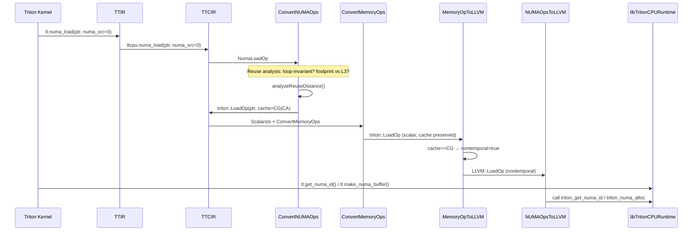
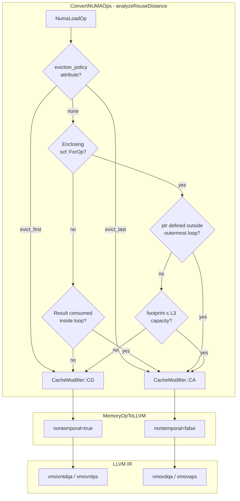

# NUMA Triton Extension — Developer Document

> **Scope**: This document describes the NUMA-aware extension for Triton-CPU, enabling efficient LLM inference on multi-socket CPU architectures. It synthesizes the design, implementation, and integration of NUMA memory placement, remote load/store operations with adaptive cache bypassing, and cross-socket synchronization.

---

## 1. Feature Overview

### Executive Summary

The **NUMA Triton Extension** adds first-class support for Non-Uniform Memory Access (NUMA) to Triton-CPU. On multi-socket servers, each CPU socket has its own directly-attached RAM. Without explicit control, the OS may place memory and threads on different nodes, causing remote accesses to traverse the interconnect—a **~40% latency penalty** compared to local access.

This feature provides:

1. **Explicit NUMA memory placement** — Allocate buffers pinned to specific NUMA nodes via `tl.make_numa_buffer`
2. **NUMA-annotated load/store** — `tl.numa_load` and `tl.numa_store` with `numa_src`/`numa_dst` attributes for remote access
3. **Adaptive cache bypassing** — Polyhedral reuse analysis selects `CacheModifier::CG` (streaming) or `CacheModifier::CA` (temporal) to emit non-temporal LLVM instructions where appropriate
4. **Cross-socket synchronization** — Lightweight `tl.numa_wait` / `tl.numa_notify` for producer-consumer coordination across NUMA nodes

### Problem Solved

| Concern | Without NUMA Extension | With NUMA Extension |
|---------|------------------------|---------------------|
| Memory placement | OS first-touch policy (unpredictable) | Explicit per-node allocation |
| Thread scheduling | OS may migrate across sockets | Pinned to NUMA node cores |
| Remote access hints | No cache bypass; pollutes L3 | Streaming loads/stores bypass cache |
| Cross-node sync | Generic locks (cache-line bouncing) | Futex-based signaling |

### Expected Behavior

- **`tl.get_numa_id()`** returns the NUMA node ID of the current execution context
- **`tl.make_numa_buffer(shape, dtype, numa_node)`** allocates memory on the specified node
- **`tl.numa_load(ptr, numa_src=N)`** loads from remote memory; the compiler assigns cache modifiers based on reuse analysis
- **`tl.numa_store(ptr, value, numa_dst=N)`** stores to remote memory; always uses non-temporal semantics
- **`tl.numa_wait(signal_id)`** blocks until signaled
- **`tl.numa_notify(signal_id, numa_dst)`** wakes a waiter on the target node

---

## 2. Architecture & System Flow

### High-Level Data Flow

```
┌─────────────────────────────────────────────────────────────────────────────┐
│ Triton Python Frontend                                                       │
│   tl.get_numa_id()  tl.make_numa_buffer()  tl.numa_load/store  tl.numa_wait  │
└───────────────────────────────────────┬─────────────────────────────────────┘
                                        │ ir.cc bindings
                                        ▼
┌─────────────────────────────────────────────────────────────────────────────┐
│ TTIR (Triton IR)                                                            │
│   tt.get_numa_id                                                            │
└───────────────────────────────────────┬─────────────────────────────────────┘
                                        │ TTIR → TTCIR
                                        ▼
┌─────────────────────────────────────────────────────────────────────────────┐
│ TTCIR (Triton CPU IR)                                                       │
│   ttcpu.make_numa_buffer  ttcpu.numa_load  ttcpu.numa_store                 │
│   ttcpu.numa_wait  ttcpu.numa_notify                                       │
└───────────────────────────────────────┬─────────────────────────────────────┘
                                        │ ConvertNUMAOps (Stage 1)
                                        ▼
┌─────────────────────────────────────────────────────────────────────────────┐
│ NumaLoadOp/NumaStoreOp → triton::LoadOp/StoreOp (cache=CG/CA)               │
└───────────────────────────────────────┬─────────────────────────────────────┘
                                        │ Scalarize + ConvertMemoryOps
                                        ▼
┌─────────────────────────────────────────────────────────────────────────────┐
│ Scalar triton::LoadOp/StoreOp (cache attr preserved)                        │
└───────────────────────────────────────┬─────────────────────────────────────┘
                                        │ MemoryOpToLLVM (Stage 2)
                                        ▼
┌─────────────────────────────────────────────────────────────────────────────┐
│ LLVM::LoadOp/StoreOp (nontemporal=true when cache==CG)                       │
└───────────────────────────────────────┬─────────────────────────────────────┘
                                        │ NUMAOpsToLLVM (Stage 3)
                                        ▼
┌─────────────────────────────────────────────────────────────────────────────┐
│ LLVM IR: calls to triton_get_numa_id, triton_numa_alloc, triton_numa_wait   │
└───────────────────────────────────────┬─────────────────────────────────────┘
                                        │ JIT / runtime
                                        ▼
┌─────────────────────────────────────────────────────────────────────────────┐
│ libTritonCPURuntime.so (runtime_numa.cpp)                                   │
└─────────────────────────────────────────────────────────────────────────────┘
```

### Mermaid Sequence Diagram: NUMA Load Path



### Mermaid Flowchart: Reuse Analysis Decision Tree



### Pipeline Ordering (Critical)

The `make_ttcir` and `make_llir` pipelines enforce a strict ordering:

| Stage | Pass | Purpose |
|-------|------|---------|
| **TTCIR** | `add_convert_numa_ops` | **First** — Rewrites NumaLoadOp/NumaStoreOp → triton::LoadOp/StoreOp before scalarization |
| TTCIR | `add_scalarize` | Decomposes tensor ops to scalar |
| TTCIR | `add_convert_memory_ops` | Handles triton::LoadOp/StoreOp (not NumaLoadOp) |
| **LLIR** | `add_memory_op_to_llvmir` | Propagates cache modifier → nontemporal on LLVM ops |
| LLIR | `add_numa_ops_to_llvmir` | Lowers remaining NUMA ops (MakeNumaBuffer, Wait, Notify, GetNumaId) and fallback for unconverted load/store |

**Why this order?** If NumaLoadOp were lowered in NUMAOpsToLLVM, the resulting triton::LoadOp would never reach MemoryOpToLLVM (which runs earlier). The two-stage design ensures NUMA load/store flow through the standard memory pipeline with cache modifiers intact.

---

## 3. Core Components & Design Decisions

### 3.1 Two-Stage Lowering

**Decision**: Split NUMA load/store handling across `ConvertNUMAOps` (TTCIR) and `MemoryOpToLLVM` (LLIR) rather than lowering directly in NUMAOpsToLLVM.

**Rationale**:
- `ConvertMemoryOps` and `ScalarizeUsingForOps` only process `triton::LoadOp`/`triton::StoreOp`, not `cpu::NumaLoadOp`/`cpu::NumaStoreOp`
- NumaLoadOp can carry tensor types (`tensor<128 x !tt.ptr<f32>>`) that require scalarization
- By rewriting to triton::LoadOp early, the generated ops inherit the full scalarize → memory-op-conversion pipeline

### 3.2 Polyhedral Reuse Analysis

**Decision**: Implement `analyzeReuseDistance()` in ConvertNUMAOps to assign `CacheModifier::CG` (streaming) or `CacheModifier::CA` (temporal) based on loop structure and access patterns.

**Rationale**:
- **KV-cache pattern**: Loop-invariant pointer, same tile every iteration → high reuse → CA (use cache)
- **Weight streaming**: IV-dependent pointer, sequential access → low reuse → CG (bypass cache)
- **Default**: When analysis is inconclusive, default to CG. Remote data that is not demonstrably reused should not pollute the local L3 cache.

**Heuristics**:
1. Explicit `eviction_policy` attribute → direct mapping
2. Loop-invariant ptr (defined outside outermost loop) → CA
3. Result consumed inside a loop (e.g., bias vector) → CA
4. Footprint (tripCount × tileBytes) ≤ 30 MB (L3 heuristic) → CA
5. Otherwise → CG

### 3.3 NumaStoreOp Always CG

**Decision**: All `NumaStoreOp` conversions use `CacheModifier::CG` and `EvictionPolicy::EVICT_FIRST`.

**Rationale**: Remote stores write to memory on another NUMA node. Caching that data locally wastes L3 capacity and provides no benefit. Non-temporal stores (`vmovntps`/`vmovntdq`) bypass the cache and write directly to memory.

### 3.4 Fallback Diagnostic Patterns

**Decision**: NUMAOpsToLLVM includes `NumaLoadOpFallback` and `NumaStoreOpFallback` patterns that emit a compiler error if unconverted NUMA load/store ops reach this pass.

**Rationale**: Safety net for pipeline ordering bugs. If ConvertNUMAOps runs correctly, these patterns never fire. If they do, the error message directs the developer to check pipeline ordering.

### 3.5 Runtime: Three-Tier Platform Abstraction

**Decision**: Graceful degradation across Linux+libnuma, Linux-only, and non-Linux.

| Tier | Memory | Pinning | Signaling |
|------|--------|---------|-----------|
| 1 (Linux + libnuma) | `numa_alloc_onnode` | `numa_sched_setaffinity` | futex |
| 2 (Linux only) | `mmap` + `mbind` | no-op | futex |
| 3 (Other OS) | `malloc` | no-op | spin-yield |

**Rationale**: Enables development and testing on systems without libnuma while providing full NUMA support when available.

---

## 4. Detailed Implementation (By Module/Domain)

### 4.1 MLIR Ops (TableGen)

**Files**: `include/triton/Dialect/Triton/IR/TritonOps.td`, `include/triton/Dialect/TritonCPU/IR/TritonCPUOps.td`

| Op | Dialect | Purpose |
|----|---------|---------|
| `tt.get_numa_id` | Triton | Returns NUMA node ID of current context |
| `ttcpu.make_numa_buffer` | TritonCPU | Allocate buffer on specified NUMA node |
| `ttcpu.numa_load` | TritonCPU | Load with `numa_src` attribute |
| `ttcpu.numa_store` | TritonCPU | Store with `numa_dst` attribute |
| `ttcpu.numa_wait` | TritonCPU | Block on signal_id |
| `ttcpu.numa_notify` | TritonCPU | Signal signal_id to numa_dst |

**NumaLoadOp** supports optional `mask` and `other` (for masked loads). The `numa_src` attribute is used by the compiler for scheduling hints; the actual cache modifier is derived by reuse analysis.

### 4.2 Python Bindings (`python/src/ir.cc`)

The `TritonOpBuilder` class exposes:

- `create_get_numa_id()` → `GetNumaIdOp`
- `create_make_numa_buffer(shape, elementType, numaNode)` → `MakeNumaBufferOp`
- `create_numa_load(ptr, numaSrc, mask, other)` → `NumaLoadOp`
- `create_numa_store(ptr, value, numaDst, mask)` → `NumaStoreOp`
- `create_numa_wait(signalId)` → `NumaWaitOp`
- `create_numa_notify(signalId, numaDst)` → `NumaNotifyOp`

`create_numa_load` infers the result type from the pointer's pointee type and handles both scalar and tensor pointer types.

### 4.3 ConvertNUMAOps (`third_party/cpu/lib/TritonToTritonCPU/ConvertNUMAOps.cpp`)

**Conversion target**: Marks `NumaLoadOp` and `NumaStoreOp` as **illegal**; all other NUMA ops remain legal.

**`analyzeReuseDistance(NumaLoadOp)`** — Key logic:

```cpp
// 1. Frontend hint
if (policyAttr == "evict_first") return CacheModifier::CG;
if (policyAttr == "evict_last")  return CacheModifier::CA;

// 2. No loops: check if result consumed inside loop
if (enclosingLoops.empty()) {
  for (user : result.getUsers())
    if (user has ancestor scf::ForOp) return CA;
  return CG;
}

// 3. Loop-invariant ptr
if (outermostLoop.isDefinedOutsideOfLoop(ptr)) return CA;

// 4. Footprint vs L3 (30 MB default)
footprint = tripCount * tileBytes;
if (footprint <= kDefaultL3CapacityBytes) return CA;

// 5. Default
return CG;
```

**NumaLoadToLoadConversion**: Creates `triton::LoadOp` with computed `cache` and `evict` (EVICT_FIRST when CG, NORMAL when CA). Handles tensor ptr types by splatting scalar mask/other to tensor shape when needed.

**NumaStoreToStoreConversion**: Always emits `triton::StoreOp` with `CacheModifier::CG` and `EvictionPolicy::EVICT_FIRST`.

### 4.4 MemoryOpToLLVM (`third_party/cpu/lib/TritonCPUToLLVM/MemoryOpToLLVM.cpp`)

**LoadOpConversion** (lines 196–210):

```cpp
bool nonTemporal = (op.getCache() == CacheModifier::CG);
rewriter.replaceOpWithNewOp<LLVM::LoadOp>(op, resTy, ptr, /*alignment=*/0,
                                          op.getIsVolatile(), nonTemporal);
```

**StoreOpConversion** (lines 213–226):

```cpp
bool nonTemporal = (op.getCache() == CacheModifier::CG);
rewriter.replaceOpWithNewOp<LLVM::StoreOp>(op, val, ptr, /*alignment=*/0,
                                           /*isVolatile=*/false, nonTemporal);
```

On x86, `nontemporal=true` produces:
- **Loads**: `vmovntdqa` (streaming load hint)
- **Stores**: `vmovntps` / `vmovntdq` (non-temporal store, bypasses cache)

### 4.5 NUMAOpsToLLVM (`third_party/cpu/lib/TritonCPUToLLVM/NUMAOpsToLLVM.cpp`)

**Direct lowerings** (ops that are not converted in ConvertNUMAOps):

| Op | LLVM lowering |
|----|---------------|
| `tt.get_numa_id` | `call @triton_get_numa_id() -> i32` |
| `ttcpu.make_numa_buffer` | `call @triton_numa_alloc(size, node) -> ptr` |
| `ttcpu.numa_wait` | `call @triton_numa_wait(signal_id)` |
| `ttcpu.numa_notify` | `call @triton_numa_notify(signal_id, node)` |

**Fallback patterns**: `NumaLoadOpFallback` and `NumaStoreOpFallback` emit `emitOpError()` with a message directing the developer to check pipeline ordering.

### 4.6 Runtime (`third_party/cpu/runtime/runtime_numa.cpp`)

**Exported symbols** (all `extern "C"` with `EXPORT` visibility):

- `triton_get_numa_id()` → NUMA node of current CPU
- `triton_numa_alloc(size_bytes, numa_node)` → NUMA-pinned allocation
- `triton_numa_free(ptr, size_bytes)` → Free NUMA allocation
- `triton_numa_pin_thread(numa_node)` → Pin thread to node
- `triton_numa_wait(signal_id)` → Block until signaled
- `triton_numa_notify(signal_id, numa_dst)` → Signal waiter

See `docs/numa_triton/numa_runtime_developer_guide.md` for full API and concurrency details.

### 4.7 Compiler Pipeline Integration

**`third_party/cpu/backend/compiler.py`**:

- `make_ttcir`: `add_convert_numa_ops(pm)` is the **first** pass (line 173), before `add_scalarize` and `add_convert_memory_ops`
- `make_llir`: `add_memory_op_to_llvmir(pm)` (line 258) before `add_numa_ops_to_llvmir(pm)` (line 261)

---

## 5. Future Considerations / Edge Cases

### 5.1 Masked Load/Store and Nontemporal

**Current limitation**: `vector::MaskedLoadOp` and `vector::MaskedStoreOp` in the MLIR version used do not support a nontemporal attribute. Tests that require nontemporal verification use **unmasked** patterns. Masked numa_load/numa_store are functionally correct but may not emit `!nontemporal` in LLVM IR.

**Mitigation**: Consider adding nontemporal support to masked vector ops upstream, or decomposing masked ops into unmasked + select for nontemporal paths.

### 5.2 L3 Capacity Heuristic

The default L3 capacity is **30 MB per socket**. This is a conservative heuristic; actual L3 size varies (e.g., 32–64 MB on modern Xeons). A future improvement could query `sysfs` or CPUID for the actual L3 size.

### 5.3 IV-Dependent Pointer Detection

The plan mentions detecting IV-dependent pointers via `tt.addptr` use-def chain analysis. The current implementation uses loop-invariance and footprint heuristics; explicit IV-dependence detection could improve accuracy for complex pointer expressions.

### 5.4 Per-Node Signal Tables

The runtime uses a **global** signal table. Cache lines holding signals may bounce between sockets during wait/notify. A future optimization could use per-NUMA-node signal tables to keep signaling traffic local.

### 5.5 `mbind` Soft Failure

If `mbind` fails (e.g., insufficient memory on the requested node), the runtime returns the pointer anyway—memory is usable but may reside on the wrong node. Performance degrades; correctness is preserved. Consider adding a runtime flag to fail hard for strict placement requirements.

### 5.6 Signal ID Collision

The signal table has 1024 slots. Each `signal_id` should be used by exactly one producer-consumer pair per synchronization round. Fan-out requires separate signal IDs. No compile-time check enforces this.

### 5.7 `eviction_policy` Frontend Wiring

The reuse analysis checks for an `eviction_policy` attribute on NumaLoadOp, but the Python frontend does not yet expose this. Adding `tl.numa_load(..., eviction_policy="evict_first")` would allow user overrides when the heuristic is wrong.

---

## Appendix: File Reference

| Domain | File | Role |
|--------|------|------|
| Ops | `include/triton/Dialect/Triton/IR/TritonOps.td` | `GetNumaIdOp` |
| Ops | `include/triton/Dialect/TritonCPU/IR/TritonCPUOps.td` | NUMA ops |
| Python | `python/src/ir.cc` | Builder bindings |
| Pass | `third_party/cpu/lib/TritonToTritonCPU/ConvertNUMAOps.cpp` | Stage 1: NumaLoad/Store → Load/Store |
| Pass | `third_party/cpu/lib/TritonCPUToLLVM/MemoryOpToLLVM.cpp` | Stage 2: cache → nontemporal |
| Pass | `third_party/cpu/lib/TritonCPUToLLVM/NUMAOpsToLLVM.cpp` | Stage 3: NUMA → LLVM calls + fallbacks |
| Runtime | `third_party/cpu/runtime/runtime_numa.cpp` | C++ runtime |
| Compiler | `third_party/cpu/backend/compiler.py` | Pipeline registration |
| Tests | `python/test/unit/cpu/numa/test_numa_bindings.py` | Runtime + bindings |
| Tests | `python/test/unit/cpu/numa/test_numa_nontemporal.py` | Nontemporal metadata |
| Docs | `docs/numa_triton/numa_runtime_developer_guide.md` | Runtime API reference |
